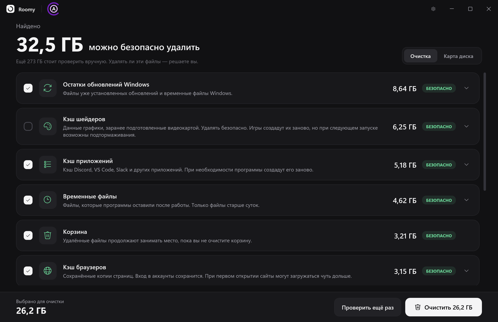
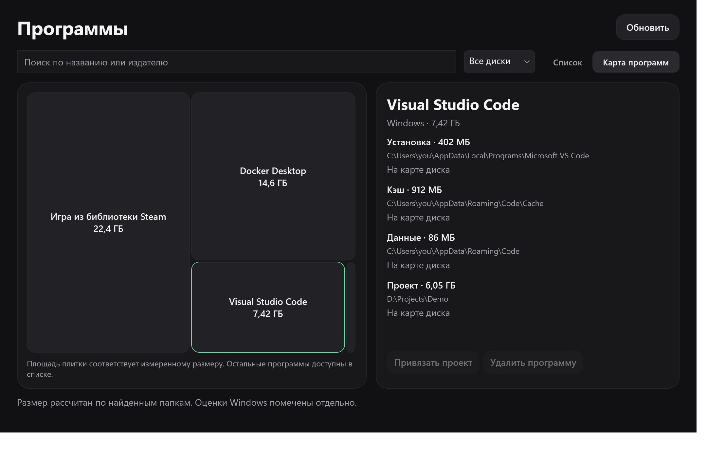

# Roomy для Windows

Roomy помогает разобраться, куда ушло место на диске. Можно начать с папки, которая внезапно выросла, или с конкретной программы и посмотреть, сколько занимают её установка, кэш, данные и связанные проекты.

**[Скачать Roomy.exe](https://github.com/LeksssGray/roomy/raw/refs/heads/main/dist/ru-brand/Roomy.exe)** · Windows 10 (2004 и новее) или Windows 11 · x64

Скачайте и запустите EXE. Устанавливать Roomy или .NET отдельно не требуется.



## Где освободить место

1. Нажмите **«Проверить компьютер»**. Roomy покажет размер временных файлов, кэша браузеров и приложений, корзины и остатков обновлений Windows.
2. Раскройте категорию, чтобы посмотреть подробности. Старые установщики и давно не запускавшиеся игры Steam вынесены в позиции для ручной проверки.
3. Проверьте выбранные категории и нажмите **«Очистить»**. Файлы, удалённые при очистке, минуют корзину. Для файлов из «Загрузок» Roomy запрашивает отдельное подтверждение, а для части системных остатков предлагает перезапуск с правами администратора.

Если нужно просто найти крупные файлы, после проверки откройте **«Карту диска»**. Выберите диск и раскройте папки. Справа отображаются самые крупные файлы в области текущего сканирования.

## Программы, проекты и остатки

Откройте **«Программы»** с главного экрана или из шапки. В список попадают классические приложения Windows, пакеты Microsoft Store и игры Steam. Поиск работает по названию, издателю, пути папки и записи реестра. Фильтр по диску показывает, где хранятся данные программы.



### Что занимает место

Выберите программу в списке или на карте. В карточке видны найденные папки установки, кэш, временные файлы, пользовательские данные и проекты. Ссылка **«На карте диска»** открывает выбранную папку подробнее.

Например, на демонстрационном снимке установка VS Code занимает около 400 МБ, кэш — 912 МБ, а проект на диске D: — больше 6 ГБ. Это три разных места на диске. Рабочие области VS Code и недавние проекты JetBrains Roomy ищет в данных самих редакторов. Для других проектов есть кнопка **«Привязать проект»**. Карточка показывает источник связи, если он известен.

Размер с пометкой **«от»** означает, что часть файлов оказалась недоступна для замера. Знак **≈** в списке программ обозначает оценку, полученную из данных приложения. Общие папки и совпадения только по имени показаны отдельно от итога программы. У сжатых и разреженных файлов размер на диске может отличаться от размера файла.

### Что осталось после удаления

Кнопка **«Удалить программу»** открывает штатное удаление через Windows Installer, настройки Windows или Steam. После завершения вернитесь в Roomy и нажмите **«Обновить»**. Если есть сопоставимые замеры, Roomy покажет изменение размера известных папок.

Переключатель **«Следы удаления»** показывает папки и записи программ, которые Roomy видел при предыдущих проверках. Для такой проверки откройте раздел **«Программы»** хотя бы один раз до удаления приложения. В блоке **«Реестр»** можно посмотреть и скопировать найденные записи установки, пути приложений, автозагрузку и службы. Сканирование диска и реестра выполняется в режиме чтения.

## Диагностика дисков

Нажмите **«Диагностика дисков»** на главном экране.

| Действие | Что открывается |
| --- | --- |
| **Проверить том** | CHKDSK для выбранной буквы диска. Windows запрашивает права администратора, проверка запускается в режиме чтения. |
| **Состояние накопителей** | Тип носителя и состояние, которое сообщает подсистема хранения Windows. |
| **Оптимизация дисков Windows** | Штатное окно Windows для анализа и оптимизации накопителей. |
| **Диагностика оперативной памяти** | Средство проверки ОЗУ. Время перезагрузки выбирается в окне Windows. |

## Настройки и данные

В настройках можно оставить Roomy в области уведомлений, включить запуск вместе с Windows и настроить напоминания о нехватке места или накопившемся кэше. Фоновые проверки показывают уведомления. Очистку запускает пользователь.

Roomy хранит данные в каталоге `%LOCALAPPDATA%\Roomy`.

| Файл | Что хранится |
| --- | --- |
| `settings.json` | Настройки приложения и фоновых проверок |
| `program-projects.json` | Ручные привязки папок к программам |
| `program-footprints.json` | Известные папки и записи для поиска следов удаления |

## Сборка и проверка

Установите .NET 10 SDK. Команды выполняются из корня репозитория.

```powershell
dotnet run --project src/Roomy -- --demo
dotnet test tests/Roomy.Tests -c Release
dotnet run --project tests/Roomy.DesktopChecks -c Release
```

Режим `--demo` использует вымышленные данные. Команда ниже собирает переносимый файл `dist/ru-brand/Roomy.exe`.

```powershell
dotnet publish src/Roomy -c Release -r win-x64 --self-contained -p:PublishSingleFile=true -p:IncludeNativeLibrariesForSelfExtract=true -p:EnableCompressionInSingleFile=true -p:DebugType=None -p:DebugSymbols=false -o dist/ru-brand
```

## Авторы и лицензия

**Доработка, локализация и знак АОС — А. О. Серов.** Развитие русской версии включает карту программ, поиск связанных папок и следов удаления, а также раздел диагностики.

Автор оригинального приложения — **krezio**. За основу взят [Roomy 0.1.2](https://github.com/krezio/roomy). Лицензия [MIT](LICENSE).
